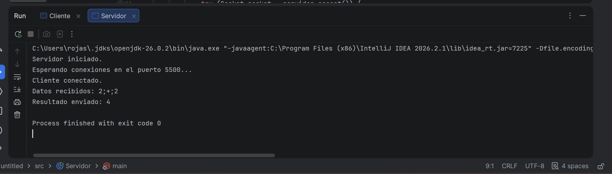
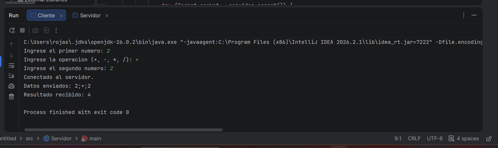

# Trabajo Práctico N° 1
## Calculadora Distribuida Cliente-Servidor

### Descripción

Este proyecto implementa una calculadora distribuida utilizando una arquitectura Cliente-Servidor y comunicación mediante sockets TCP en Java.

El Cliente solicita al usuario dos números enteros y una operación matemática (+, -, * o /). Luego envía los datos al Servidor mediante un Socket TCP.

El Servidor recibe los datos, realiza la operación correspondiente y devuelve el resultado al Cliente.

### Tecnologías utilizadas

- Java
- API java.net
- Socket TCP
- ServerSocket
- IntelliJ IDEA

### Puerto utilizado

El Servidor utiliza el puerto: 5500

### Ejecución del Servidor

Primero se debe ejecutar la clase `Servidor.java`.

El servidor queda esperando conexiones en el puerto 5500.

### Servidor en ejecución

### Ejecución del Cliente

### Cliente en ejecución

Luego se debe ejecutar la clase `Cliente.java`.

El Cliente solicita:

1. Primer número.
2. Operación matemática.
3. Segundo número.

Los datos son enviados al Servidor con el siguiente formato: `15;+;30`

### Ejemplo de funcionamiento

Entrada: `2 + 2`

Resultado: `4`

### División por cero
Si el usuario intenta realizar una división por cero, el Servidor devuelve:

`ERROR: Division por cero`

### Servidor apagado
Si el Cliente intenta conectarse cuando el Servidor no está ejecutándose, se produce una 
`ConnectException` y se muestra un mensaje indicando que no se pudo establecer la conexión.

### Identifique en su código qué línea bloquea la ejecución del programa hasta que ocurre un evento de red.
El cliente se queda detenido en readLine() hasta que el servidor envíe una respuesta.
Mientras no llegue nada, el programa no avanza.

`String resultado = entrada.readLine();`

El servidor se queda detenido en accept() hasta que un cliente intente conectarse.
Mientras no haya conexión, el programa no avanza.

`Socket socket = servidor.accept();`

### Comunicación entre dos notebooks

Para ejecutar el Cliente y el Servidor en diferentes notebooks conectadas a la misma red Wi-Fi, se debe reemplazar `localhost` en el Cliente por la dirección IP de la notebook donde se ejecuta el Servidor.

También debe estar disponible el puerto 5500 y la comunicación no debe ser bloqueada por el firewall.